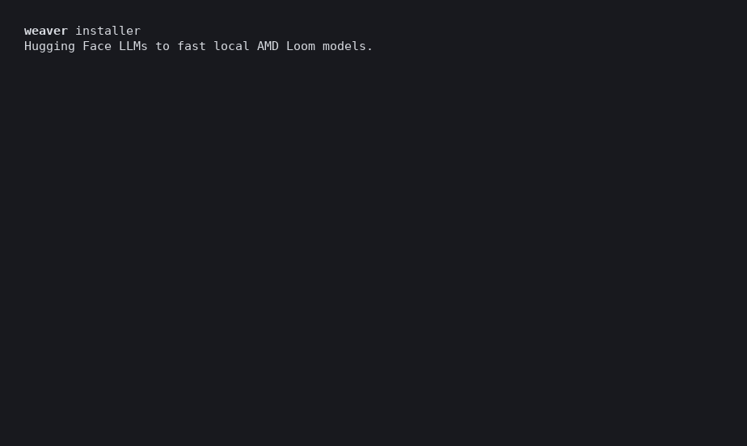

# weaver

Takes a Hugging Face LLM to a fast, validated [AMD Loom](https://github.com/ROCm/hrx-system) model,
running entirely on your machine:

```sh
curl -fsSL https://github.com/loom-fun/weaver/releases/latest/download/install.sh | bash
weaver serve huggingface://unsloth/Qwen3.5-0.8B-GGUF      # port it, validate it, serve it, open the chat UI
```

The installer offers to run `weaver init` (fetch and start the local agent model) at the end.



weaver runs the [loom skills](https://github.com/loom-fun/loom-skills) with a **local** coding agent:
[Pi](https://github.com/earendil-works/pi) driving Qwen3.8-27B
([loom-fun/bartowski-Qwen3.8-27B-loom](https://huggingface.co/loom-fun/bartowski-Qwen3.8-27B-loom): Q4_K_M,
MTP speculative decoding, 262k context) on loom-serve. Nothing goes to a cloud model.

## Commands

| Command | What it does |
|---|---|
| `weaver init` | Checks the machine, fetches and serves the agent model, smoke-tests Pi against it, and pre-fetches the llama.cpp ROCm reference. Running it again is safe. |
| `weaver serve CHECKPOINT` | Serves the model on `:8080` and opens the Loom playground on `:8090`. A published Loom package or catalog model is fetched and served directly; anything else is ported first. Ctrl-C stops everything. |
| `weaver port CHECKPOINT` | The agent ports the checkpoint (`port.sh`), qualifies it against llama.cpp ROCm (gates, baselines, speculative-decoding choice) and finalizes it (full gates, audit, report). No optimization loop. |
| `weaver optimize CHECKPOINT [TARGET] [BUDGET]` | Ports if needed, then optimizes. TARGET is `roofline` (default), `beat-llamacpp` or e.g. `decode+30%`. BUDGET is e.g. `90m` or `3h` (default: the skills' 30 min × the local-agent slowdown factor). |
| `weaver upload CHECKPOINT HF-ORG` | Publishes the package (programs, `model.json` pointing at the upstream GGUF, `model.json.lock`) and a model card in the [loom-fun](https://huggingface.co/loom-fun) style. Shows a preview and asks before publishing. |
| `weaver agent [-m CHECKPOINT]` | An interactive Pi session with the loom skills on the local agent model, or, with `-m`, on CHECKPOINT (served first, like `lemonade launch pi -m`). |
| `weaver agent-server start\|stop\|status\|bench` | Manage the agent model server (`:8079`). |
| `weaver doctor` | What this machine is missing, and how to fix it. |
| `weaver skills [update \| use PATH \| use bundled]` | Which loom skills the agent uses and how they compare with loom-skills main; switch to the latest, or to your own checkout (`WEAVER_SKILLS=PATH` for one command). |

While a port or optimize runs, weaver shows its plan, checks off each step of the skills' scripts as it
finishes, and estimates the time left. The estimates come from how long each step took on this machine
before (`~/.local/share/weaver/timings.jsonl`, scaled by model size). The tasks are:
- **Convert:** build the model's GPU kernels, test each one, and get a first answer.
- **Verify:** compare its answers with llama.cpp token by token, and measure both engines.
- **Speed up** (optimize only): try optimizations, keeping each one only if it is faster and still correct.
- **Final check:** run every correctness check up to the full context length, take the final speed
  measurements and write the report.

`-v` also shows every command the agent runs.

CHECKPOINT is `huggingface://org/repo[:file.gguf]`, `org/repo`, or a huggingface.co URL. By default
ports use plain Q4_K_M from your HF cache, and speculative decoding is on whenever the GGUF supports
it (`--no-spec` turns it off).

## Requirements

- Linux x86-64 with glibc 2.39 or newer (Ubuntu 24.04 or newer). Windows will follow.
- An AMD GPU with `/dev/kfd` access. Developed on Strix Halo (gfx1151, 128 GB).
- About 64 GB of RAM at minimum. The agent model holds about 42 GiB while it works.
- bash, curl, ss, pgrep, unzip and tar, which almost every distribution has. No Python, Node.js,
  ROCm SDK or git needed.

## Install

```sh
curl -fsSL https://github.com/loom-fun/weaver/releases/latest/download/install.sh | bash
```

It checks the machine, downloads the release tarball (150 MB) and verifies it against the release's
`SHA256SUMS`. It unpacks the tarball to `~/.local/share/weaver/<version>/` and links `weaver` into
`~/.local/bin`, adding that to your shell's PATH if it isn't there. Then it asks whether to run
`weaver init` now. The bundle holds:
- a relocatable CPython 3.12;
- `hrx-loom[hf]` 0.1.0;
- the Pi binary;
- the pinned loom-skills;
- the matching hrx-loom-library.

Run the same command again to upgrade. Options go after `bash -s --`:
- `--version 0.1.4` installs a specific release.
- `--no-init` and `--init` skip the init question, answering no or yes.
- `--uninstall` removes weaver. Your Hugging Face cache is kept.

`WEAVER_HOME`, `WEAVER_BIN_DIR` and `WEAVER_NO_MODIFY_PATH=1` change where it goes and what it touches.
To try a pull request before it is released, install its CI build. This needs `gh`, signed in, because
GitHub serves CI artifacts only to signed-in users:

```sh
curl -fsSL https://raw.githubusercontent.com/loom-fun/weaver/refs/pull/N/head/install.sh | bash -s -- --pr N
```

Running the normal install command later goes back to the latest release.

If you'd rather read it first: `curl -fsSLO …/install.sh; less install.sh; bash install.sh`.

Or from source, into a Python 3.12+ environment:

```sh
git clone --recursive https://github.com/loom-fun/weaver && cd weaver
pip install .            # weaver init then downloads the pinned Pi release
```

All state lives under `WEAVER_HOME` (default `~/.local/share/weaver`). Weaver uses its own Pi config,
so `~/.pi` is not touched unless you pass `weaver agent --user-config`.

## Building the bundle

```sh
git submodule update --init
packaging/build_bundle.sh          # -> packaging/out/{weaver-linux-x64.tar.gz,install.sh,SHA256SUMS}
WEAVER_RELEASE_URL=file://$PWD/packaging/out bash install.sh       # install that build
```

Every downloaded input is pinned with its sha256 in `packaging/versions.env`.

## What has been verified

On Strix Halo (gfx1151, 128 GB), with the local agent (details in [evals/results.md](evals/results.md)):
- `weaver port` Qwen3.5-0.8B: full gates and audit PASS in 24.7 min, as fast as the Claude Code trials.
- `optimize`, `serve` (a published package, a catalog card, and a finished port), the chat UI, `agent` and `agent -m`, and `upload` all worked, including serving the uploaded repo from a fresh install.
- `weaver port` of Bolt-E4B (gemma4 E4B): full gates and audit PASS in 97.5 min, through the gemma4 reference example (Claude Code took 43.5).

Known issues:
- The catalog Qwen3.8-27B card at hrx-loom 0.1.0's pinned library revision does not link on 0.1.0 (`root symbol '@text_chat_reasoning_v1' was not found`). Serve `huggingface://loom-fun/bartowski-Qwen3.8-27B-loom` instead.
- Some published loom-fun packages were built with a newer SDK and do not compile on 0.1.0 (Bolt-E4B-4GB). `weaver port` the GGUF instead.
- The release binary in a clean Ubuntu 24.04 container.

## Evals

See [evals/README.md](evals/README.md): unit tests, a clean-container check, a Strix Halo smoke test,
and agent task evals (port / optimize / serve) on reference models, graded with the skills' own
correctness gates.
